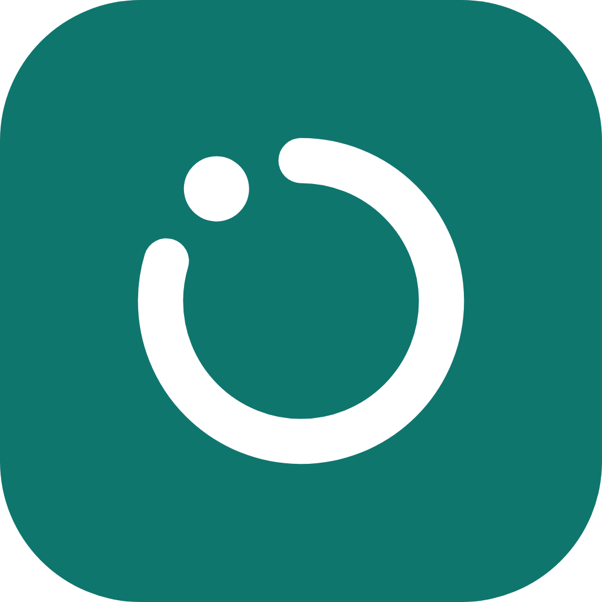
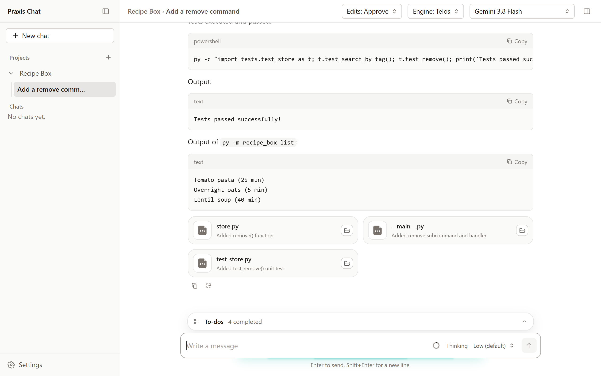
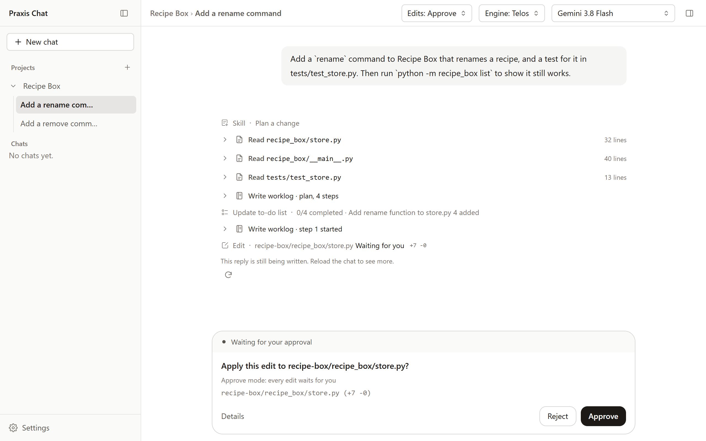
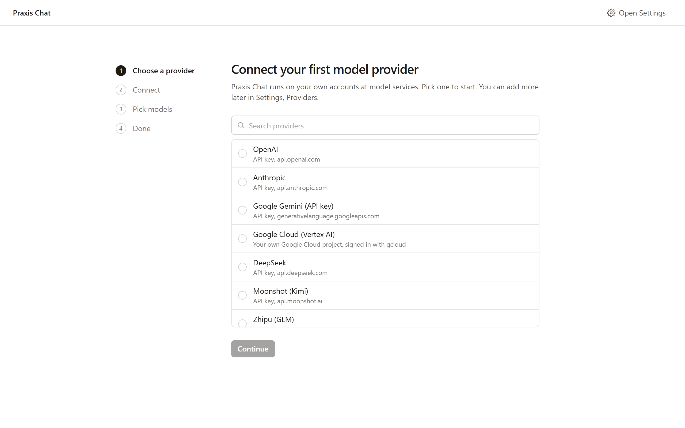

  

<h1 align="center">Praxis Chat</h1>

  A private AI workspace for Windows. 
  Your models, your files, your PC.

  
  
  
  

  

  Free beta · One installer · Updates itself

  <picture>
    <source media="(prefers-color-scheme: dark)" srcset="assets/screenshots/agent-dark.png">
    
  </picture>

---

## What it does

| Feature | Details |
| --- | --- |
| **Chat with the models you choose** | OpenAI, Anthropic, Google, DeepSeek, Moonshot, Zhipu, MiniMax, xAI, Mistral, Groq, OpenRouter, Together, Fireworks, or any OpenAI-compatible server, with your own account. |
| **Work with your projects** | Add a folder or upload files. The app indexes them so answers cite the right file. |
| **An agent that does the work** | It reads, searches, edits files and runs PowerShell commands in a folder you pick. Every change can wait for your approval, and edits can be undone. |
| **A worklog you can follow** | Each step the agent takes shows as a clear row you can open. Plans, decisions and results are kept per project. |
| **Long chats stay usable** | A context meter shows how full the conversation is; it compacts itself at 80%, keeping the details that matter. |

## How the agent works

Praxis Chat has two agent engines. You pick one per chat, and both run on
whichever model provider you connect.

### Telos Beta

Praxis's own agent engine, built into the app.

- **Real tools on your files**: read, search (glob and grep), write and
  edit files, and run Windows PowerShell commands, including long ones as
  background jobs you can check on and stop.
- **You stay in charge.** Every change and command follows the chat's edit
  mode:
  - **Approve**: everything waits for you.
  - **Auto**: safe commands run, the rest waits.
  - **Bypass**: everything runs.

  Rules you write add to that, for example "always allow `git status`" or
  "never read `*.env`".
- **Hard limits no rule can lift.** The agent stays inside the folder you
  chose, never touches secret files or the `.git` folder, writes a plan
  before it changes anything, and you can undo every edit.
- **Steady on long tasks.** Reads run side by side to save time. Guards
  stop a model that keeps repeating the same call.

### Praxis Harness

The full-featured engine for long, many-step work. Every model call goes
through your own providers, and Praxis's approvals and rules sit in front of
every tool it uses. It adds:

- **Helpers**: the agent hands side work, such as a wide search or a
  review, to helper agents running alongside it.
- **Goals**: the agent keeps working round after round until a goal you set
  is met.
- **Plan mode**: the agent plans with read-only tools and changes nothing
  until you approve the plan.
- **Workflows, worktrees, code navigation and terminals**: some are switched
  on in Settings.

### Context that holds up

The context meter shows how much of the model's window a chat uses. At 80%
the chat compacts itself into a detailed summary: the goal, the work done,
open hypotheses and the current step. The summary is kept, so a long task
carries on after a restart.

## See it work

<table>
  <tr>
    <td width="50%"></td>
    <td width="50%"></td>
  </tr>
  <tr>
    <td align="center">Every change waits for you in Approve mode</td>
    <td align="center">First start: connect your own provider</td>
  </tr>
</table>

## Install

1. Click **[Download for Windows](https://github.com/shanmukhram/praxis-chat-releases/releases/latest/download/Praxis-Chat-Setup.exe)**. It downloads the installer,
   `Praxis-Chat-Setup.exe`, the latest version. All versions are under
   [Releases](../../releases).
2. Run it. The app installs and opens; nothing else to install.
3. Connect a model provider with your own API key, or your Google Cloud
   account, on the setup screen.

The app updates itself when a new version is released.

<b>"Windows protected your PC" when you run the installer?</b>

 

The beta installers are not signed yet, so Windows shows this warning for
new apps. Click **More info**, then **Run anyway**. Signed installers will
follow in a later release.

<b>System requirements</b>

 

- Windows 10 or 11, 64-bit
- About 1 GB of free disk space
- An internet connection to reach your model provider

## Privacy

> **Your data stays on your PC.** Chats, projects, files and settings are
> stored locally. Prompts go only to the provider you connect, for the chats
> that use it.

- No telemetry, no analytics, no account with us.
- API keys are kept in Windows Credential Manager, never in plain files.
- The only other request the app makes is a check of this repository for
  new versions.

Read the full [privacy note](PRIVACY.md) and the [license](LICENSE.md).

## Credits

- Praxis Harness builds on the open-source
  [DeepSeek Harness](https://github.com/deepseek-ai/deepseek-harness)
  (MIT license), extended and wired into Praxis.
- Telos's design is inspired by Claude Code.

Praxis Chat is an independent project, not affiliated with DeepSeek or
Anthropic.

## Feedback

Found a bug or have an idea? **[Open an issue](../../issues/new)**.

Please include your app version (Settings) and the steps to repeat the
problem. Never paste API keys or private data into an issue.

---

  Praxis Chat by Overmind Labs · <a href="LICENSE.md">License</a> · <a href="PRIVACY.md">Privacy</a> 
  This repository holds the installers and release notes. The source code is not published here. 
  Open-source licenses for the bundled parts ship with the app.

